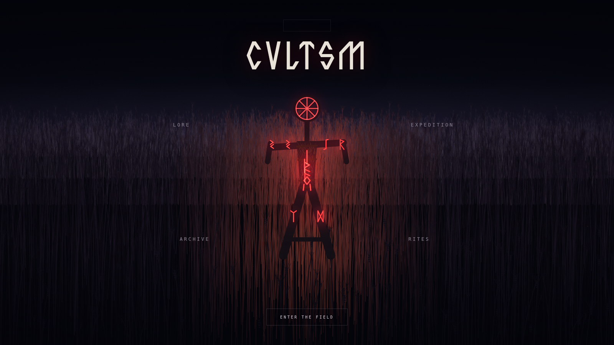

# CVLTSM

An immersive dark-fantasy landing page: a wheat field at night, a bound effigy
standing in the middle of it with runes burning down its body, and the menu
arranged around it. Rendered entirely in the browser — no image assets, no
sprite sheets on disk, no build step.



## What it is

Every mark in the scene is generated procedurally at load from a fixed seed —
the stars, the treeline on the horizon, some twelve thousand stalks of wheat,
the effigy and the sixteen runes cut into it. One canvas, sized to the display's
device pixels, with nothing upscaled and no pixel grid.

**Nothing responds to the pointer or the wheel.** The field moves because the
wind moves. Scrolling belongs to the interface.

## The scene

| Layer | What it is |
|-------|------------|
| Sky | A deep gradient, stars thinning toward the horizon, a bank of haze, and a ragged treeline biting into it. Baked once. |
| Crop, far to near | Four depth bands, each lower, darker, coarser and swaying further than the one behind it. |
| The effigy | A harvest figure bound out of timber and straw — splayed legs, a bundled torso, arms on a crossbeam, a sun wheel for a head. |
| Fire | The bloom around the runes and the halo around the body, breathing. |
| Chaff | Motes lifting off the crop. |
| Near crop | The stalks close enough to bend individually, drawn over everything. |

### How the crop moves

Redrawing twelve thousand stalks a frame would look no better and cost a
hundred times as much, so each band is drawn once into its own surface and then
animated by **shearing it in horizontal slabs** — the top of a band shifts
further than its base, which is how a head of wheat actually moves.

Two details that took measuring to get right:

- The wave travels *up* the stem, so a slab's height shifts the wind's phase —
  but only slightly. Feeding a slab's `y` straight into the wind's *horizontal*
  term swung the phase wildly between neighbouring slabs and tore each band
  into horizontal steps.
- Slabs abut exactly. An earlier version overlapped them by a row as insurance
  against gaps, but shearing only moves a slab sideways — vertically they
  already tile — and the shared row was composited twice at two different
  offsets, printing a faint dark line across the crop every slab.

A band whose feet all sat on one line ended in a razor edge, and wherever that
edge fell the crop density dropped off a cliff. Feet sink over a range instead,
and the nearest band sinks right off the bottom of the frame: standing in a
crop, there is no ground line to see.

### How the light works

The effigy's fire is baked **into the stalks themselves**, tinting each one by
how close it stands to the fire. An earlier version laid a single big `screen`
gradient over the finished field instead; it left hard rectangular banding
across the crop, and even without the artefact a flat wash over the top is not
what light in a field looks like.

## Branding slots

Two slots in `index.html` are waiting for real artwork, both marked with
comments:

- **Manufacturer logo** — `<div class="crest__mfr" id="mfrLogo">`, directly
  above the wordmark. Drop an `` straight in; the empty placeholder frame
  disappears automatically once an image is present.
- **CVLTSM wordmark** — the `<h1>`, currently set in Valhalica
  (`fonts/Valhalica-Regular.otf`). Replace its contents with the official logo
  `` when it arrives; the styling already handles an image.

## Interface

The four sections sit in a ring **around the effigy**, centred on the figure
itself: the engine exposes its position and the ring is placed from that, so
the menu stays arranged around it at any window size. Below 720px wide the ring
collapses to a row.

Each item raises a **slide-up section panel** over the scene — the canvas is
never scrolled or transformed, so the background stays exactly where it is
while the panel travels. The page behind is marked `inert` while the panel is
modal, focus is trapped and restored, and Escape closes.

The panel carries three request states, all reachable today:

| State | When | What it shows |
|-------|------|---------------|
| Loading | while the section is fetched | pulsing indicator, `aria-busy` |
| Empty | the section has no entries | "Nothing filed here yet" |
| Error | the fetch failed or timed out | the reason, plus a retry that clears the cache |

Section content is fetched from `content/<section>.json`, shaped
`{ "items": [{ "title": "…", "body": "…" }] }`. The files ship empty, which is
why every section currently shows the empty state.

## Request layer

`js/net/client.js` wraps `fetch` with the things a page needs to survive a bad
network:

- **Timeouts** — every attempt gets its own `AbortController` deadline.
- **Retries** — exponential backoff with full jitter, on network failures,
  408, 429 and 5xx only. `Retry-After` is honoured when present. Writes are
  never retried blind.
- **De-duplication** — concurrent callers asking for the same key share one
  in-flight promise.
- **Idempotent writes** — `submitOnce(url, body, { idempotencyKey })` will not
  post twice: a key already in flight returns that promise, a key already
  settled returns its result. The key is also sent as `Idempotency-Key`.
- **Read cache** — TTL cache in memory and `sessionStorage`, so reopening a
  section costs nothing.
- **Client quota** — a token bucket that refuses to flood an endpoint.

Two honest caveats. A client-side quota is a politeness guard, **not** rate
limiting: it lives in the page and anyone can bypass it by not using the page.
Likewise `Idempotency-Key` only prevents duplicate work if the server honours
it. Both have to be enforced server-side to mean anything.

## Logging

`js/lib/log.js` emits flat JSON records with a stable shape
(`ts`, `level`, `event`, `session`, …) and keeps the last 200 in a ring
buffer. `window.onerror` and `unhandledrejection` are captured. Nothing is
shipped anywhere by default — `log.setSink(fn)` is where a collector plugs in.
`window.CVLTSM.logs()` dumps the buffer for a bug report.

## Performance

Every baked layer is a **surface**: a canvas sized in device pixels, carrying
the transform that lets it be painted in ordinary screen coordinates, so it
blits one to one. Getting this wrong was the single largest cost in the scene —
layers built at CSS-pixel size and blitted through the main context's device
transform are *magnified* every frame, four times over on a retina display and
nine on a phone, and everything baked into them comes out soft.

A surface also carries an origin, so a layer that covers part of the frame can
be cropped to what it actually paints rather than blitting a screenful of
transparency. The effigy stands in about a tenth of the frame and its bloom in
rather less.

Three findings worth keeping, all measured at 1920×1080:

- **Canvas shadows are not affordable live.** The rune bloom was drawn with
  `shadowBlur` on every stroke: 5.9fps, against 60.5 with the fire pass off
  entirely. It is baked once now and blitted with a breathing alpha, while the
  sharp cores are stroked live without any shadow so each rune still flickers
  on its own.
- **Batching paths can make things slower.** The cost of an antialiased path
  scales with its *bounding box*, and the near stalks are long and scattered
  right across the frame. One path per colour group measured 51fps and one path
  for all of them 46, against 55 for a stroke per stem. The baked bands, which
  are dense and local, do batch — the tint there is quantised into ten levels
  so stalks sharing a colour go into one path each.
- **A head of grain is rigid.** It rides on the top of the stem and the bend
  barely reshapes it, so each one is baked into a small sprite at build and
  stamped at the stalk's top every frame. Only the stems are still paths.

The sky layer has to cover the *whole* frame, not just the part of it that is
sky. It is the only layer painted over the previous frame, so wherever it was
transparent nothing was ever cleared, and the crop and chaff below the treeline
accumulated there frame after frame.

Also: a fixed-timestep accumulator rather than a raw `dt`; rendering pauses on
`visibilitychange`; layers rebuild on a debounced resize; the device pixel
ratio is capped at 2.

## Accessibility

- `prefers-reduced-motion: reduce` stops the field entirely — no wind, no
  chaff, no breathing fire. The scene is held at a fixed instant.
- The canvas carries a descriptive `aria-label`; the interface is keyboard
  navigable with visible focus rings, and there is a `<noscript>` fallback.

## Audio

None. The page is silent: no music, no audio files, no Web Audio — nothing
that can make a sound.

## Testing

```sh
npm run lint
npm run test:load       # 12 concurrent sessions, self-serving
```

The load test is shaped around what this site actually is. There is no
application server to saturate; every visitor generates the whole scene in
their own browser, so the load is on the client. It measures a **baseline**
session alone on the machine (tight budget: boot and framerate) and then N
**concurrent** sessions, where it asserts correctness strictly — all boot, zero
errors — but only loosely gates framerate, because N headless browsers share
one CPU on the runner and real visitors do not share a CPU with each other.

## Running it

A static site — serve the directory over HTTP (ES modules will not load from
`file://`):

```sh
npm start                       # or: python3 -m http.server 8000
```

Then open <http://localhost:8000>.

## Layout

```
index.html           markup + interface overlay
css/style.css        interface, ring, panel, grain, responsive rules
fonts/               Valhalica, the display face
js/main.js           boot: wires field, ring, panel and logging together
js/field/engine.js   canvas sizing, fixed timestep, layer order
js/field/surface.js  device-resolution offscreen layers
js/field/sky.js      night, stars, haze, treeline, ground
js/field/wheat.js    the crop: baked bands, shearing, the near stalks
js/field/effigy.js   the bound figure, its runes, its fire
js/field/runes.js    the rune stroke paths and the sun wheel
js/field/palette.js  the scene palette
js/field/color.js    colour mixing and the falloff of the firelight
js/net/client.js     timeouts, retries, dedupe, quota, read cache
js/ui/panel.js       slide-up section panel + loading/empty/error states
js/lib/log.js        structured logging and global error capture
content/*.json       section content (ships empty)
tests/load.mjs       concurrent session load test
archive/pixel-wood/  the previous design, kept whole — see its own README
```

## Seed

The field is deterministic. Change `SEED` in `js/field/engine.js` to grow a
different one under the same rules.

## The previous design

The original pixel-art forest — six parallax layers, a traveller walking
forever, a pack chasing him, a rite burning between the trees and a hidden
side-scrolling game behind ten clicks on the wordmark — is kept whole and
runnable in [`archive/pixel-wood/`](archive/pixel-wood/README.md). It is not
the live site; it is there to be picked back up.
